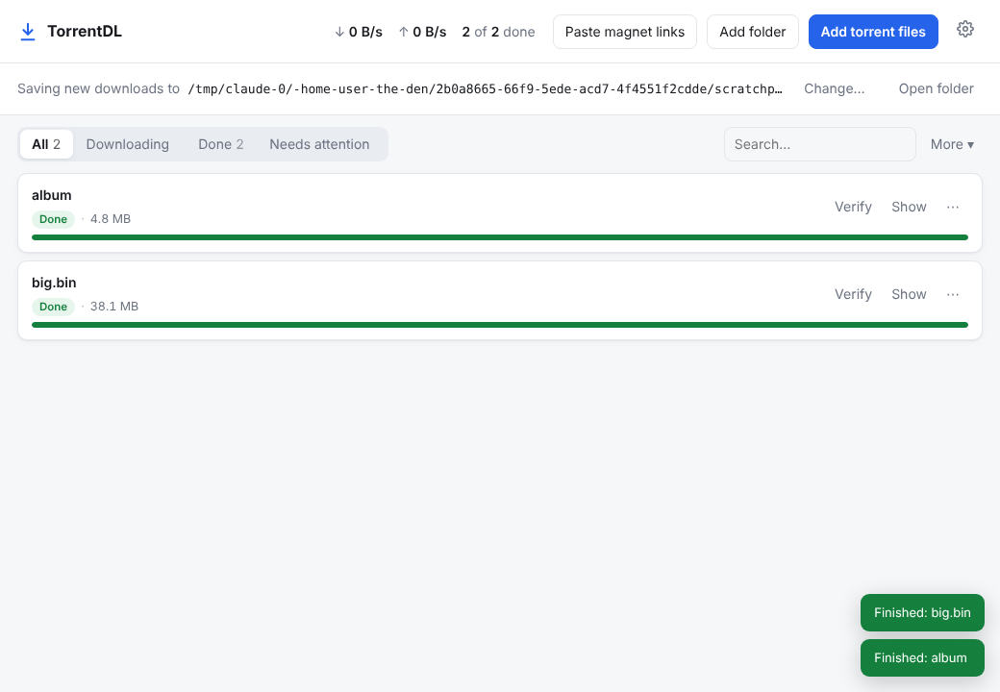

# TorrentDL

A simple desktop app for downloading your old torrent backups. Drag in a folder
full of `.torrent` files, pick where to save them, and leave it running.



## Download

Get the latest version from the **[Releases page](../../releases/latest)**:

| Your computer | File |
| --- | --- |
| Windows 10 / 11 | `TorrentDL-Windows.exe` |
| Mac with Apple Silicon (M1, M2, M3, M4…) | `TorrentDL-Mac-AppleSilicon.dmg` |
| Older Intel Mac | `TorrentDL-Mac-Intel.dmg` |

Not sure which Mac you have? Open  → **About This Mac**. "Chip: Apple M…" means Apple Silicon.
The Mac builds need macOS 14 (Sonoma) or newer.

### First launch

The app isn't signed by Apple or Microsoft yet, so the first time you open it
you'll see a warning. You only have to do this once:

- **Windows:** "Windows protected your PC" → click **More info** → **Run anyway**.
- **Mac:** open the `.dmg` and drag TorrentDL into Applications. Open it once and
  you'll see "can't be opened". Go to **System Settings → Privacy & Security**,
  scroll down, click **Open Anyway** next to TorrentDL, and confirm.

## Using it

1. Click **Add folder** and choose the folder with your `.torrent` files. It looks
   through subfolders too. You can also drag files or folders onto the window,
   or paste magnet links.
2. Downloads go to `Downloads/TorrentDL` by default. Click **Change…** to pick
   another folder, such as an external drive.
3. That's it. A few download at a time and the rest wait their turn.

Good to know:

- **Close it whenever you like.** Progress is saved. Reopen the app and
  everything carries on where it left off.
- **Files you already have aren't downloaded again.** If some of the data is
  already in the save folder, it's checked and only missing or damaged parts
  are fetched.
- **"Needs attention"** lists torrents that nobody is sharing right now. The
  app keeps looking and starts on its own if someone comes online. Old
  torrents only download if another computer somewhere still shares them. If
  you still have the files on another machine, open TorrentDL (or any torrent
  app) there with the same torrents to share them.
- **Faster downloads:** allow the app through your firewall, and forward the
  port shown in Settings on your router if you know how.
- Your list and settings are kept in `%APPDATA%\TorrentDL` (Windows) or
  `~/Library/Application Support/TorrentDL` (Mac).

## Command-line version

`torrent_dl.py` does the same job from a terminal, for scripts or servers:

```bash
pip install libtorrent
python3 torrent_dl.py ~/backups/torrents -o ~/Restored
```

Run `python3 torrent_dl.py --help` for options.

## Building from source

```bash
pip install -r requirements-app.txt
python3 app.py                 # run it
pyinstaller TorrentDL.spec     # build a standalone app into dist/
```

GitHub Actions builds the Windows and Mac apps on every push. Pushing a tag
like `v1.0.1` publishes a release with the downloads attached.

How it's put together: `torrentdl/engine.py` drives
[libtorrent](https://libtorrent.org); `torrentdl/server.py` exposes it to the
interface (`torrentdl/web/index.html`) over a local-only connection that needs
a per-launch secret token; `app.py` shows it in a native window using
[pywebview](https://pywebview.flowrl.com).
